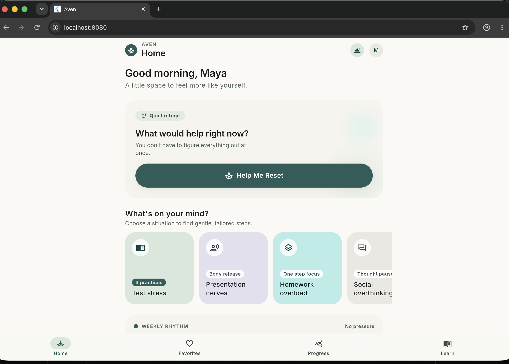

# Aven

A quiet, restorative space for stress reduction, nervous system regulation and
emotional balance.

Aven deliberately avoids streaks, scores and productivity pressure. The
interface is built around generous negative space, low-stimulation colour and
soft, tactile surfaces — the goal is a calm place to land, not another thing to
keep up with.

The visual language is defined by the **Serene Sanctuary** design system: deep
botanical teal (`#285C59`) on a warm mineral canvas (`#FAF9F4`), Inter
throughout, pill-shaped controls and roomy 24px card corners.



<sub>The home dashboard as it currently appears. Captured at desktop width — the
design targets a 360–428px phone viewport, so reach for the DevTools device
toolbar to see it at its intended size.</sub>

---

## Current status

| Area | State |
|---|---|
| Home dashboard | Complete |
| Bottom navigation | Shell working (Home, Favorites, Progress, Learn) |
| Favorites / Progress / Learn | Placeholder screens, intentionally unfinished |
| "Help Me Reset" flow | Not wired — the CTA only plays its acknowledgement animation |
| Remaining blueprint screens | Not started (reset choice, stress recommendations, breathing exercise) |

---

## Prerequisites

- **Flutter** 3.47.x stable (Dart 3.13.x)
- A target to run on: Chrome for a quick preview, or Xcode / Android SDK for a
  real device experience

Verify your setup at any time:

```sh
flutter doctor
```

### Platform toolchains

| Target | Requirement | Notes |
|---|---|---|
| Web | Chrome | Easiest, fastest loop |
| iOS | Xcode (full install) + a simulator runtime | Xcode 26 downloads the iOS platform on demand — see below |
| macOS | Xcode with the macOS SDK | Ships with Xcode |
| Android | Android SDK + a JDK | Create an AVD once, then run |

<details>
<summary>Verified working configuration (the setup this project was built against)</summary>

| Component | Version | Location |
|---|---|---|
| Flutter / Dart | 3.47.7 / 3.13.5 | `~/development/flutter` |
| Xcode | 26.2 | `/Applications/Xcode.app` |
| iOS simulator runtime | 26.3.1 | `/Library/Developer/CoreSimulator/Volumes` |
| CocoaPods | 1.17.0 | `/opt/homebrew/bin/pod` |
| OpenJDK | 21 | `/opt/homebrew/opt/openjdk@21` |
| Android SDK | 36 (build-tools 36.0.0, NDK r28c) | `/opt/homebrew/share/android-commandlinetools` |

The shell environment adds the following to `~/.zshrc`:

```sh
export PATH="$HOME/development/flutter/bin:$PATH"
export JAVA_HOME="/opt/homebrew/opt/openjdk@21/libexec/openjdk.jdk/Contents/Home"
export ANDROID_HOME="/opt/homebrew/share/android-commandlinetools"
export ANDROID_SDK_ROOT="$ANDROID_HOME"
```

Points worth knowing if you rebuild this setup from scratch:

- Selecting Xcode requires root once:
  `sudo xcode-select --switch /Applications/Xcode.app/Contents/Developer`, then
  `sudo xcodebuild -runFirstLaunch`.
- Xcode 26 no longer bundles the iOS platform. Without it, `xcodebuild` reports
  *"iOS 26.2 is not installed"* and Flutter surfaces the confusing
  *"No Xcode build settings have been found"*. Install it with:
  `xcodebuild -downloadPlatform iOS` — this does **not** need `sudo`.
- Point Flutter at the JDK and Android SDK without touching system paths:
  `flutter config --jdk-dir <path>` and `flutter config --android-sdk <path>`.

</details>

---

## Running the app

Every command below assumes you start from the project root:

```sh
cd aven
flutter pub get
```

### Web — quickest way to see it

```sh
flutter run -d chrome --web-port 8080
```

Opens in Chrome at `http://localhost:8080` with DevTools attached.

To serve without launching a browser:

```sh
flutter run -d web-server --web-port 8080
```

> The design targets a phone viewport of 360–428px. At desktop width the layout
> will look stretched, so open DevTools, toggle the device toolbar
> (`Cmd+Shift+M`) and pick a phone such as *iPhone 17 Pro*.

### macOS

```sh
flutter run -d macos
```

### iOS Simulator

Simulators only appear in `flutter devices` **after** they are booted, so start
one first:

```sh
open -a Simulator
flutter devices                      # confirm the simulator is listed
flutter run -d "iPhone 17 Pro"
```

Available devices on this machine: `iPhone 16e`, `iPhone 17`, `iPhone 17 Pro`,
`iPhone 17 Pro Max`, `iPhone Air` (all iOS 26.3.1).

To run on a physical iPhone, pair it in **Xcode → Window → Devices and
Simulators** first, then sign it with a development team for an installable
build.

### Android

An emulator has to exist before it can be launched. Create one once:

```sh
sdkmanager "system-images;android-36;google_apis;arm64-v8a"
avdmanager create avd -n pixel \
  -k "system-images;android-36;google_apis;arm64-v8a" \
  -d pixel_7
```

Then launch and run:

```sh
flutter emulators --launch pixel
flutter run
flutter run -d emulator-5554        # if more than one device is available
```

---

## Development workflow

While `flutter run` is active:

| Key | Action |
|---|---|
| `r` | Hot reload — near-instant, preserves state |
| `R` | Hot restart — resets state |
| `q` | Quit |

Note that the key commands belong to the terminal running `flutter run`, so run
it yourself rather than detaching it.

### Checks

```sh
flutter analyze     # static analysis — expected: No issues found!
flutter test        # 5 tests covering greeting, layout, CTA and navigation
```

The test suite includes a narrow-phone (360px) layout test. Flutter reports
`RenderFlex` overflow as a test failure, so that test guards the smallest
supported viewport.

---

## Building

```sh
flutter build web --release
flutter build apk --debug
flutter build ios --no-codesign     # device build without signing
flutter build macos --debug
```

`build/` is git-ignored and will not appear in commits.

---

## Project structure

```
lib/
├── main.dart                  App entry point
├── theme/
│   ├── app_colors.dart        Colour tokens from the design system
│   ├── app_spacing.dart       Spacing and corner-radius tokens
│   ├── app_text_styles.dart   Inter typographic scale
│   └── app_theme.dart         Assembles tokens into ThemeData
├── models/
│   ├── situation.dart         Situation and Technique value types
│   └── home_data.dart         Static dashboard content
├── screens/
│   └── home_screen.dart       App shell + home dashboard
└── widgets/
    ├── app_bottom_nav.dart    Translucent blurred navigation bar
    ├── reset_hero_card.dart   "Help Me Reset" hero
    ├── situation_card.dart    Carousel card
    ├── weekly_rhythm_card.dart
    ├── technique_tile.dart
    ├── somatic_video_card.dart
    └── section_heading.dart

assets/
├── fonts/                     Inter 400 / 500 / 600 (+ OFL license)
└── images/                    Bundled thumbnail for the somatic card

docs/
└── screenshots/               Images referenced by this README

test/
└── widget_test.dart
```

### Notes on the implementation

- **Fonts are bundled, not fetched.** Inter is vendored under `assets/fonts/`
  (from the upstream `rsms/inter` v4.1 release, SIL Open Font License) so the
  app renders identically offline and in tests. Weight discipline is deliberate:
  only 400 / 500 / 600 are used, and heavier weights are excluded to avoid
  aggressive hierarchies.
- **Colour and spacing tokens live in one place.** Screens compose from
  `AppColors` / `AppSpacing` / `AppTextStyles` rather than hardcoding values,
  so the palette stays the single source of truth.
- **Letter-spacing is converted.** The design tokens express tracking in `em`;
  Flutter expects logical pixels, so the values in `app_text_styles.dart` are
  the `em` figures multiplied by each style's font size.
- **Shadows are pigment-tinted** (`#253330` at very low opacity) rather than
  synthetic black, mimicking soft diffused light.
- **The greeting is time-aware** — it reads "Good morning", "Good afternoon" or
  "Good evening" based on the device clock, rather than a fixed string.
- **The avatar is a placeholder.** The blueprint uses a stock portrait; this
  build uses a sage disc with an initial so no third-party likeness is bundled.

---

## Roadmap

1. Wire the "Help Me Reset" CTA into the reset-choice flow.
2. Build the stress-test recommendations and gentle breathing exercise screens.
3. Replace the placeholder Favorites / Progress / Learn tabs.
4. Swap `home_data.dart` for a repository once content becomes dynamic.

---

## License

Inter is vendored under `assets/fonts/` under the SIL Open Font License,
Version 1.1. The full text ships alongside the font files in
`assets/fonts/LICENSE.txt`.

Copyright (c) 2016 The Inter Project Authors — https://github.com/rsms/inter
